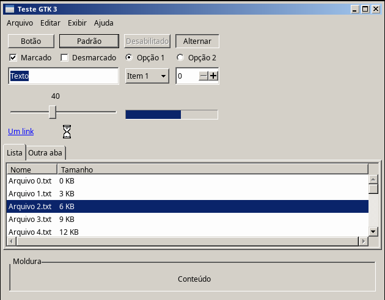
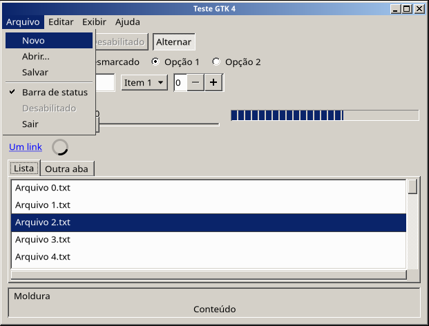

# GTK: Windows Classic

Tema GTK que reproduz o **Clássico do Windows XP** nos aplicativos GTK, com as mesmas cores do estilo Qt "Windows" e da paleta `windows-classic` do LXQt. Assim, apps GTK (Firefox, GIMP, Thunar, Mousepad...) e apps Qt ficam iguais na mesma sessão.

| GTK 3 | GTK 4 / libadwaita |
|---|---|
|  |  |

| Versão | Pasta | Situação |
|---|---|---|
| GTK 3 | `windows-classic/gtk-3.0` (+ links `gtk-3.22` e `gtk-3.24`) | ✅ |
| GTK 4 e libadwaita | `windows-classic/gtk-4.0` | ✅ |

Não há tema GTK 2: o `gtk2` saiu dos repositórios oficiais do Arch, e nenhum app instalado pelos repositórios usa mais essa versão.

O tema é instalado na mesma pasta do tema do Openbox (`themes/windows-classic`): um só nome de tema para as janelas e para os widgets.

## Origem

O GTK 3 e o GTK 4 são derivados do tema **Win2k** ([smileyzn/win2k](https://github.com/smileyzn/win2k)), que é baseado no [Chicago95](https://github.com/grassmunk/Chicago95). O que mudou para o XP Clássico (nos dois, salvo indicação):

| O quê | Win2k | Aqui (XP Clássico) | Origem |
|---|---|---|---|
| Sombra escura dos relevos (ButtonDkShadow) | `#000000` | `#404040` | `I386/HIVEDEF.INF` (64 64 64) |
| Moldura do botão padrão, retângulo de foco (WindowFrame) | `#000000` | `#000000` (nova cor `@window_frame`) | `HIVEDEF.INF` (0 0 0) |
| Calha da barra de rolagem | branco liso | xadrez de `#FFFFFF` e `#D4D0C8`, como no XP e no estilo Qt "Windows" | `HIVEDEF.INF` (Scrollbar 212 208 200) |
| Links | `#0A246A`, com sombra | `#0000FF`, visitados `#800080`, sublinhados | paleta Qt do projeto |
| Botão padrão / pressionado | sem moldura / afundado | moldura preta / preta + cinza, texto 1 px abaixo | `DrawFrameControl` do Windows |
| Itens de menu marcados | caixa de seleção | só o glifo ✓ ou • | `DFCS_MENUCHECK` / `DFCS_MENUBULLET` |
| Moldura dos menus sem compositor | nenhuma | relevo de 2 px do XP | veja "Limitações" |
| Animação do Explorer (Thunar, só GTK 3) | do Windows 2000 | tirada do XP: idêntica | `I386/BROWSEUI.DL_`, bitmap 306 |
| Barra de título CSD (GTK 4) | 22 px, botões 18x18 com ícones simbólicos | 18 px, botões 16x14 com os glifos em pixel art do tema do Openbox, degradê também no libadwaita | `HIVEDEF.INF` (CaptionHeight) |
| Moldura da janela CSD sem compositor (GTK 4) | relevo de botão, 2 px | `EDGE_RAISED` de janela, 4 px (`#D4D0C8`/`#FFFFFF` por fora, `#808080`/`#404040` por dentro) | `DrawEdge` do Windows |

Foram removidos o que só fazia sentido no XFCE e no Windows 2000: Whisker Menu, ajustes do painel do XFCE e do MATE, tela de login do LightDM, Cinnamon e as faixas "Windows 2000".

As outras cores do esquema Clássico (face `#D4D0C8`, seleção `#0A246A`, títulos `#0A246A → #A6CAF0` e `#808080 → #C0C0C0`, dicas `#FFFFE1`) já eram as mesmas no Windows 2000.

### Imagens

- `tools/xp-dkshadow.py` converteu, uma única vez, a sombra escura das imagens herdadas do Win2k (`gtk-3.0` e `gtk-4.0/assets`): um pixel preto vizinho de um pixel `#808080` faz parte de um relevo e vira `#404040`. Glifos e a moldura preta do botão pressionado não encostam no cinza e continuam pretos. O script pode ser rodado de novo sem efeito (é idempotente).
- Os glifos dos botões da barra de título do GTK 4 (`gtk-4.0/assets/titlebutton-*.png`) são os `.xbm` do tema do Openbox (`../Openbox/build.sh`) convertidos para PNG.
- `build.sh` gera o que vem da mídia do XP (a animação do Explorer) e o que é desenhado em pixel art (calha da barra de rolagem e glifos do menu, copiados também para o `gtk-4.0`):

```bash
./build.sh /caminho/para/I386
```

## Instalação

```bash
sudo ./install.sh              # instala em /usr/share/themes/windows-classic
```

Depois, ative no seu usuário:

```bash
./install.sh --apply
```

- **GTK 3 e GTK 4:** grava `gtk-theme-name=windows-classic` em `~/.config/gtk-3.0/settings.ini` e em `~/.config/gtk-4.0/settings.ini`.
- **libadwaita:** os apps libadwaita ignoram o `gtk-theme-name` e só leem `~/.config/gtk-4.0/gtk.css`. Por isso o script põe nesse arquivo uma linha marcada (`/* windows-classic-lxqt: tema GTK 4 */`) com um `@import` do `gtk.css` do tema. O resto do arquivo fica como está.
- **Backup:** tudo é feito com backup (`*.bak.AAAAMMDDhhmmss`). Para desfazer no libadwaita, apague essa linha.

O GTK 3 também pode ser ativado em **Configurações do LXQt → Aparência → Estilo GTK**. O LXQt grava a escolha em `~/.config/gtk-3.0/settings.ini` junto com a fonte (Noto Sans 9).

Padrão do sistema, para quem não escolheu outro tema (não alcança os apps libadwaita):

```bash
sudo ./install.sh --default    # /etc/xdg/gtk-3.0/settings.ini e /etc/xdg/gtk-4.0/settings.ini
```

Apps já abertos continuam com o tema antigo até serem reabertos (ou até o `xsettingsd` avisar, se estiver instalado).

Para testar sem mexer no sistema, instale só no seu usuário (`./install.sh`, em `~/.local/share/themes`) e abra um app forçando o tema:

```bash
GTK_THEME=windows-classic gtk3-widget-factory   # pacote gtk3-demos
GTK_THEME=windows-classic gtk4-widget-factory   # pacote gtk4-demos
```

## Limitações conhecidas

- **Menus sem compositor**: sem o picom, o GTK 3 não dá decoração CSD à janela dos menus. O tema herdado desenhava a moldura só na decoração, e os menus apareciam sem borda. Aqui o próprio menu desenha a moldura nesse caso (`window.popup:not(.csd) > menu`). Com o picom, a decoração CSD é usada.
- **libadwaita**: o título fica centralizado na barra (no XP ele fica à esquerda). A posição é decidida pelo app, não pelo CSS.
- **GTK 4.24**: o `GtkSpinner` aparece como um círculo girando. A ampulheta do Win2k foi feita para o GTK 4.22 e, no teste com o 4.24, não aparece.
- O **botão padrão** só tem a moldura preta quando nenhum outro botão está com o foco. O GTK 3 faz como o Windows e passa o "padrão" para o botão focado.
- O `MessageDialog` do GTK 3.24 não mostra ícone, e os botões ocupam a largura toda. No XP, os botões têm 75x23 px e ficam centralizados.
- Os comentários do CSS herdado ainda citam o Windows 2000 e o Windows 95 em vários lugares, e os do GTK 4 estão em inglês, como no Win2k. As medidas são as mesmas no XP Clássico.
