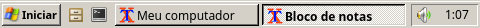

# LXQT — Windows Classic

Tema do LXQt (painel, menu Iniciar, Executar e notificações) e paleta de cores no padrão **Clássico do Windows XP**. Foi feito para o estilo Qt **Windows**, que já vem no LXQt e desenha botões, menus e os botões das tarefas no padrão Clássico.



## Conteúdo

| Arquivo | O que faz |
|---|---|
| `Windows-Classic/lxqt-panel.qss` | Barra de tarefas com relevo, botão **Iniciar**, menu Iniciar com a faixa lateral, bandeja afundada com o relógio e dicas amarelas |
| `Windows-Classic/lxqt-runner.qss` | Executar (Alt+F2) com moldura e botão de fechar do Classic |
| `Windows-Classic/lxqt-notificationd.qss` | Notificações no estilo do balão do XP |
| `Windows-Classic/wallpaper.cfg` | Fundo sólido `#3A6EA5` (de `../Wallpapers`) |
| `Windows-Classic/images/` | Imagens geradas por `build.sh` |
| `palettes/Windows-Classic` | Paleta de cores do esquema Clássico |
| `menu/` | Menu Iniciar no formato do XP (arquivo `.menu`, entradas e pastas) |

## De onde vem cada recurso

| Recurso | Origem |
|---|---|
| Bandeira do botão Iniciar (16×16) | `I386/EXPLORER.EX_`, bitmap 176 |
| Faixa "Windows XP Professional" do menu Iniciar | `I386/EXPLORER.EX_`, bitmap 167 |
| Cores (face `#D4D0C8`, destaque `#0A246A`, dicas `#FFFFE1`…) | `I386/HIVEDEF.INF` → `Control Panel\Colors` |
| Relevos 3D, setas e botão de fechar | Desenhados em `build.sh`, com as cores acima |

Para gerar as imagens de novo: `./build.sh /caminho/para/I386`.

## Menu Iniciar do XP

`menu/windows-classic-applications.menu` organiza o `mainmenu` como o menu Iniciar clássico do XP:

```
Programas ▸        (Acessórios ▸ [Acessibilidade ▸, Ferramentas do sistema ▸], Gráficos ▸, Internet ▸, Jogos ▸...)
Documentos ▸       (Meus documentos, Minhas imagens, Minhas músicas)
Configurações ▸    (Painel de controle + configurações do sistema)
Pesquisar ▸        (Arquivos ou pastas...)
Ajuda e suporte
Executar...
───────────────
Fazer logoff...
Desligar o computador...
```

No primeiro nível, os ícones têm 32 px e os itens 48 px, como no XP. Nos submenus, os ícones têm 16 px. Os nomes têm tradução para pt_BR, e os ícones usam nomes freedesktop (`folder-documents`, `system-run`, `system-shutdown`…), que o tema de ícones deve fornecer.

## Instalação

```bash
sudo ./install.sh        # /usr/share/lxqt/themes e /usr/share/lxqt/palettes
./apply.sh               # no seu usuário: tema, paleta, estilo Windows e Noto Sans 9
./apply.sh --panel       # idem, e o painel no layout do XP
```

O `apply.sh` faz backup de `~/.config/lxqt/lxqt.conf` e `panel.conf`. Com `--panel`, o painel fica assim: **Iniciar** (menu clássico `mainmenu`, com o menu do XP e sem o campo de busca), Inicialização rápida (mantém os seus atalhos), tarefas com até 160 px e bandeja (ícones, volume e relógio), com 28 px de altura. O texto do botão segue o idioma ("Iniciar" em português).

Também dá para fazer tudo à mão em **Configurações do LXQt → Aparência**: tema do LXQt "Windows-Classic", estilo dos widgets "Windows" e paleta "Windows-Classic".

## Observações

- O menu do XP é o **`mainmenu`** (menu em cascata). O `fancymenu` (duas colunas) tem o mesmo botão Iniciar, mas não usa arquivos `.menu`, então não recebe a estrutura do XP.
- O `menu_file` precisa do caminho completo: o painel não procura o nome em `~/.config/menus`.
- No `lxqt-panel` 2.x, toda seção de plugin no `panel.conf` precisa de `type=` (por exemplo, `type=mainmenu`). Sem isso o plugin não é carregado, e nenhum erro aparece.
- O botão Iniciar não fica "afundado" enquanto o menu está aberto: o painel não informa esse estado ao tema.
- A bandeja vira uma caixa só, do primeiro ícone até o relógio, quando os plugins estão na ordem `statusnotifier, tray, volume, worldclock`.
