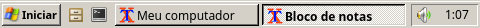

# Windows Classic para LXQt

Tema completo para o **LXQt** que reproduz o tema **Clássico do Windows XP**: janelas, barra de tarefas, menu Iniciar, cursores, papéis de parede, sons e tela de logon.



Os recursos (cores, medidas, imagens, cursores e sons) foram tirados da mídia de instalação do **Windows XP Professional SP3**, quase sempre dos arquivos `.INF` e das DLLs da pasta `I386`. Cada componente tem um `build.sh` para gerar tudo de novo a partir da sua própria ISO. A fonte é a **Noto Sans**; nenhuma fonte da Microsoft é usada.

## Componentes

| Pasta | O que é | Situação |
|---|---|---|
| [`Wallpapers`](Wallpapers) | 20 papéis de parede do XP, 11 texturas em mosaico e o fundo sólido `#3A6EA5` | ✅ |
| [`Fonts`](Fonts) | Noto Sans + substituição de Tahoma / MS Sans Serif / MS Shell Dlg pela Noto Sans | ✅ |
| [`Openbox`](Openbox) | Tema de janelas: barra de título em degradê, botões do Classic, moldura de 4 px | ✅ |
| [`Cursors`](Cursors) | Cursores padrão do XP (32 e 64 px) | ✅ |
| [`Sounds`](Sounds) | Os 35 sons `.wav` do XP (só os arquivos: o LXQt não tem sons de evento) | ✅ |
| [`LXQT`](LXQT) | Painel, botão e menu Iniciar do XP, Executar, notificações e paleta de cores | ✅ |
| [`Extras/Picom`](Extras/Picom) | Opcional: relevo 3D de 2 px nas janelas e sombra dos menus, via picom | ✅ |
| [`SDDM`](SDDM) | Tela de logon clássica do XP ("Fazer logon no Windows") | ✅ |
| `Icons` | Tema de ícones | 🚧 em andamento |

## Instalação

Requisitos no Arch Linux:

```bash
sudo pacman -S --needed lxqt openbox noto-fonts
```

Instalação no sistema, componente por componente:

```bash
sudo Wallpapers/install.sh
sudo Fonts/install.sh
sudo Openbox/install.sh
sudo Cursors/install.sh
sudo LXQT/install.sh
sudo SDDM/install.sh --enable   # tela de logon (vale no próximo boot)
```

Ativação no seu usuário (cada script faz backup do que altera):

```bash
Openbox/install.sh --apply     # tema, fonte e ordem dos botões no ~/.config/openbox/rc.xml
Cursors/install.sh --apply     # cursor no LXQt (vale no próximo login)
LXQT/apply.sh --panel          # tema, paleta, estilo Windows e painel no layout do XP
pkill -x lxqt-panel            # a sessão reabre o painel

Extras/Picom/install.sh        # opcional, requer picom e aceleração 3D
```

Também dá para ativar à mão em **Configurações do LXQt → Aparência**: tema "Windows-Classic", estilo dos widgets "Windows", paleta "Windows-Classic" e tema do Openbox "Windows-Classic".

Cada pasta tem um `README.md` com os detalhes, a origem de cada recurso e as limitações conhecidas.

## Gerar de novo a partir da ISO

Com a pasta `I386` da mídia do Windows XP:

```bash
Openbox/build.sh                        # glifos dos botões (pixel art, não usa a ISO)
Cursors/build.sh /caminho/para/I386
LXQT/build.sh    /caminho/para/I386
SDDM/build.sh    /caminho/para/I386
```

## Referências

- [pixelocdguy/windows-classic](https://github.com/pixelocdguy/windows-classic): tema semelhante para LXQt, usado como ponto de partida para algumas ideias do painel.
- [smileyzn/win2k](https://github.com/smileyzn/win2k): tema Windows 2000 para XFCE; base dos cursores.

## Aviso

Windows, Windows XP e as imagens, cursores e sons incluídos são marcas e obras da Microsoft Corporation. Este projeto não tem relação com a Microsoft.
