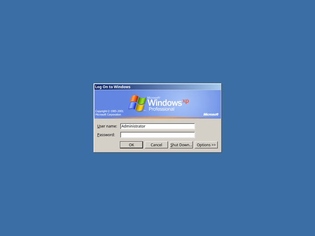

# SDDM: Windows Classic

Tema do SDDM que reproduz a **tela de logon clássica do Windows XP**: o diálogo cinza "Fazer logon no Windows" sobre o fundo sólido da área de trabalho. É o logon que o XP mostra com o tema Clássico (a tela de boas-vindas azul é do visual Luna).



Requer **SDDM 0.21 ou mais novo com Qt 6** (`sddm-greeter-qt6`). O tema usa só o QtQuick básico, sem Plasma nem QtQuick.Controls.

## De onde vem cada recurso

| Recurso | Origem no XP |
|---|---|
| Faixa "Windows XP Professional" (411x88) | `I386/MSGINA.DL_`, bitmap 107 |
| Faixa pequena do "Desligar o Windows" (411x72) | `I386/MSGINA.DL_`, bitmap 101 |
| Barra colorida sob a faixa (411x5), que corre durante o logon | `I386/MSGINA.DL_`, bitmap 103 |
| Ícone do computador do "Desligar o Windows" | `I386/MSGINA.DL_`, ícone 22 |
| Ícone de informação (falha no logon) e de aviso (Caps Lock) | `I386/USER32.DL_`, ícones 104 e 101 |
| Layout dos diálogos | `I386/MSGINA.DL_`, diálogos 1500 (logon), 2200 (desligar) e 2507 (falha) |
| Cores e cor de fundo `#3A6EA5` | `I386/HIVEDEF.INF` → `HKCU\Control Panel\Colors` |
| Fonte | **Noto Sans** 12 px, como no resto do tema (no XP era Tahoma 8) |

Os bitmaps têm 413 px de largura, mas as duas últimas colunas são lixo: o diálogo tem 274 DLU = 411 px e mostra só as primeiras 411 colunas. O `build.sh` corta as imagens nessa largura.

As posições dos controles são as DLUs dos diálogos do `msgina.dll`, convertidas com a fonte MS Shell Dlg 8 (1 DLU = 1,5 px na horizontal e 1,625 px na vertical): campos de 20 px de altura, botões de 75x23 px, campos começando em 84 px e terminando em 327 px. Em português os rótulos são mais largos, e os campos começam logo depois do rótulo mais largo.

As imagens já vêm geradas em `windows-classic/images`. Para gerá-las de novo:

```bash
./build.sh /caminho/para/I386
```

## O que funciona

- **Fazer logon no Windows**: nome de usuário (já preenchido com o último usuário) e senha com `*`, como no Clássico. Os botões são OK, Cancelar, Desligar... e Opções.
- **Opções >>** expande o diálogo para baixo e mostra **Fazer logon em:**. No XP essa caixa escolhia o domínio; aqui ela escolhe a sessão (LXQt, Openbox...).
- **Desligar...** abre o diálogo "Desligar o Windows", com Desligar e Reiniciar, mais Em espera e Hibernar se a máquina permitir.
- **Mensagem de logon**: aparece quando a senha está errada. O diálogo de logon fica inativo atrás, com o título cinza.
- Balão **"Caps Lock ativado"** sob o campo de senha, como no XP. Clique nele para fechar.
- Teclado como no Windows: Tab, Enter (botão padrão), Esc (Cancelar), Alt+letra sublinhada, Alt+↓/F4 nas caixas de combinação. A moldura preta de "botão padrão" passa para o botão com foco.
- Os diálogos podem ser arrastados pela barra de título.
- Textos em português quando o sistema está em `pt_*`, e em inglês nos outros idiomas.

## Instalação

```bash
sudo ../Cursors/install.sh       # opcional: cursor do XP também na tela de logon
sudo ./install.sh --enable       # instala e ativa
```

O `--enable` cria `/etc/sddm.conf.d/windows-classic.conf` com `Current=windows-classic` e, se os cursores estiverem instalados, `CursorTheme=windows-classic`. Se o arquivo já existir, ele faz backup antes.

Ele também instala `/usr/share/sddm/scripts/windows-classic-xsetup` e o define como `[X11] DisplayCommand`. O SDDM roda esse script como root antes da tela de logon:

- **Resolução**: aplica a configuração de monitor que o último usuário salvou no LXQt (`[currentConfig]` de `~/.config/lxqt/lxqt-config-monitor.conf`; o usuário vem de `/var/lib/sddm/state.conf`). Sem isso, a tela de logon fica no modo que o driver escolhe (numa VM, o tamanho da janela, ex.: 2415x1171) e só muda depois do login. O script só aceita números e nomes de saída válidos, porque lê um arquivo do usuário.
- **Cursor do fundo**: o SDDM define o cursor da janela raiz com `xsetroot`, mas desiste depois de 1 s ("Could not setup default cursor" no `journalctl -u sddm`), o que acontece no boot. O script define de novo, sem esse limite.
- Antes disso, roda o `Xsetup` original do SDDM.

Para testar o script sem mudar a tela: `XRANDR=echo LXQT_MONITOR_CONF=~/.config/lxqt/lxqt-config-monitor.conf ./windows-classic-xsetup` mostra os comandos do `xrandr`. A mudança vale no próximo boot ou após `sudo systemctl restart sddm`, que **encerra a sessão gráfica**.

Sem o `--enable`, o script só copia o tema para `/usr/share/sddm/themes/windows-classic`.

Para testar sem sair da sessão e sem instalar nada no sistema, rode dentro desta pasta:

```bash
sddm-greeter-qt6 --test-mode --theme windows-classic
```

No modo de teste o greeter não fala com o SDDM: o OK não faz logon e o Desligar não desliga.

## Configuração

Em `/usr/share/sddm/themes/windows-classic/theme.conf.user` (crie o arquivo, que sobrepõe o `theme.conf` e não é apagado ao reinstalar):

```ini
[General]
color=#3A6EA5                                          # cor de fundo
background=/usr/share/wallpapers/windows-classic/Bliss.jpg   # imagem (vazio = só a cor)
backgroundMode=fill                                    # stretch, fill, fit, center ou tile
```

Os papéis de parede do XP são instalados por [`../Wallpapers`](../Wallpapers).

## Limitações conhecidas

- Não existe a tela "Pressione Ctrl+Alt+Del para iniciar a sessão": o diálogo de logon aparece direto, como no XP sem essa opção.
- A caixa de seleção "Fazer logon usando conexão dial-up" e o botão Ajuda do "Desligar o Windows" foram omitidos, porque não teriam função.
- O XP só mostra os sublinhados das letras de atalho depois de apertar Alt. Aqui eles aparecem sempre, como nas capturas do logon clássico.
- Em telas HiDPI o diálogo continua com o tamanho em pixels do XP. Use `GreeterEnvironment=QT_SCALE_FACTOR=2` na seção `[General]` do `sddm.conf` para ampliar.
- Com vários monitores, o fundo vai para todos e o diálogo fica no monitor principal.
